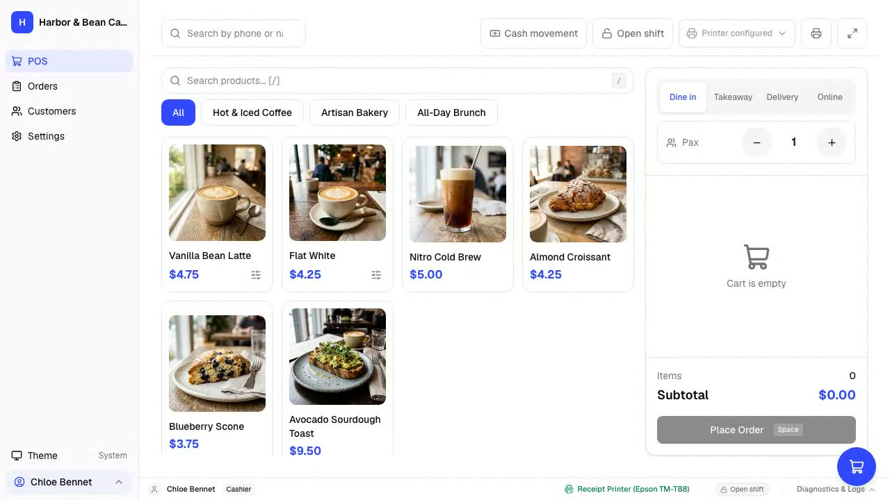
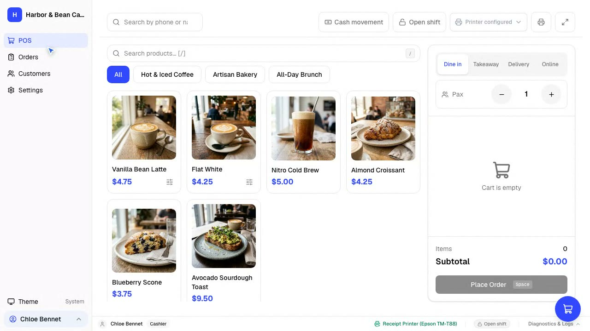
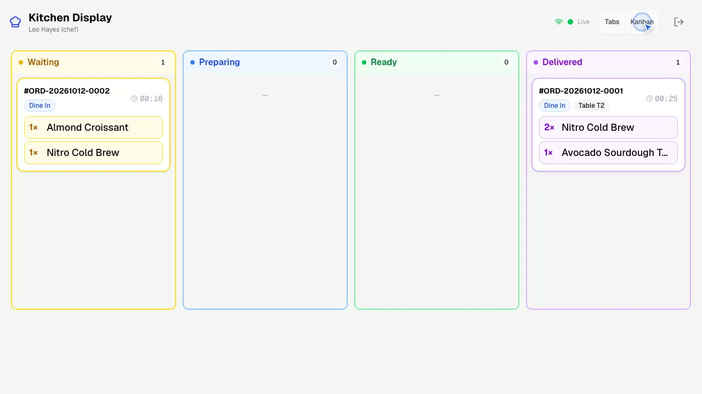
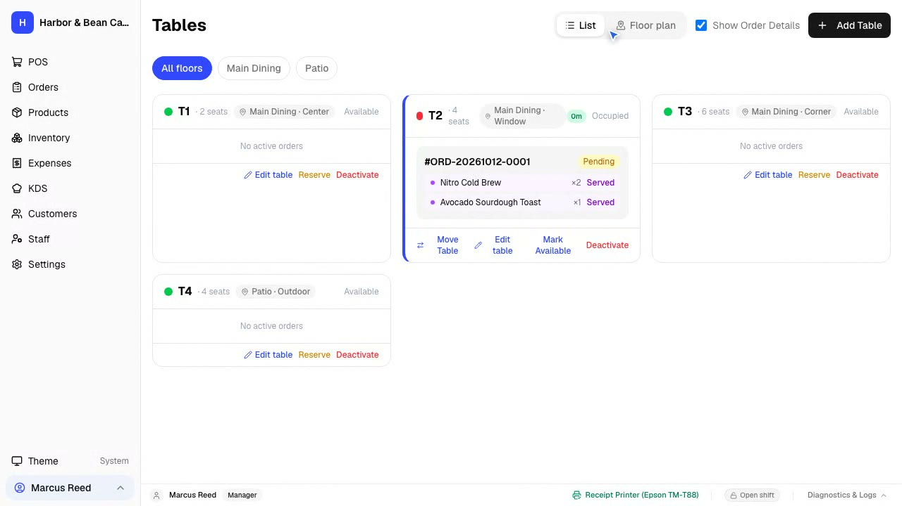
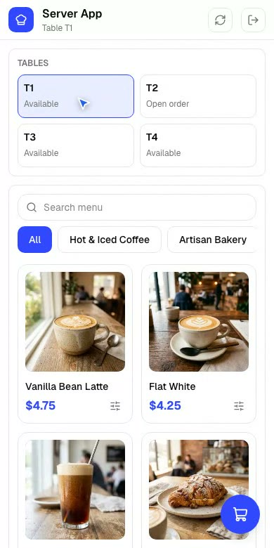
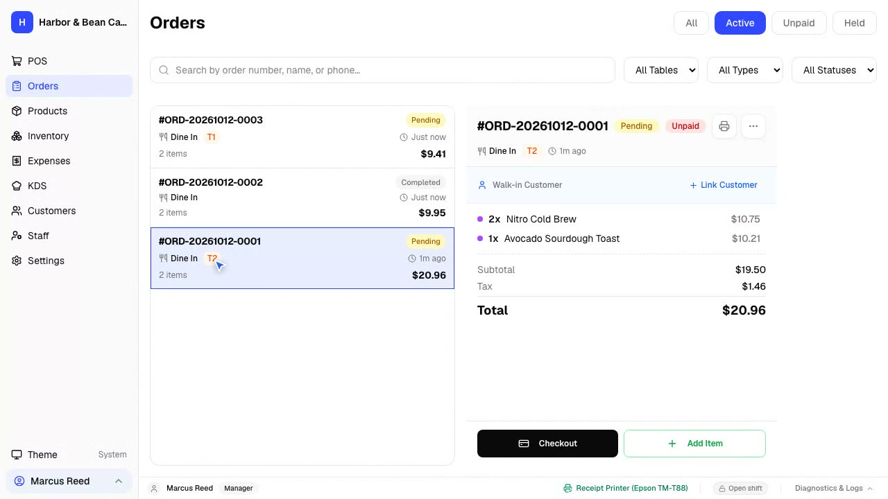
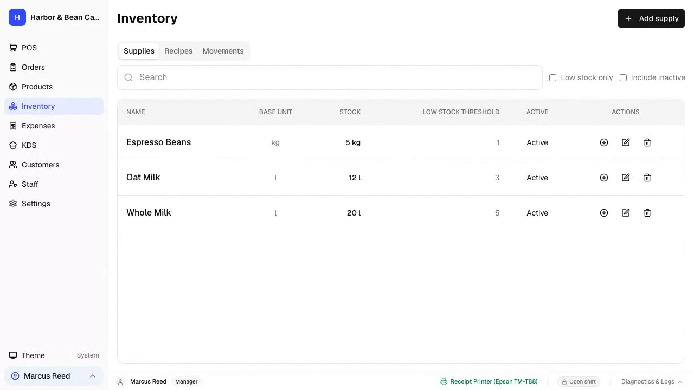
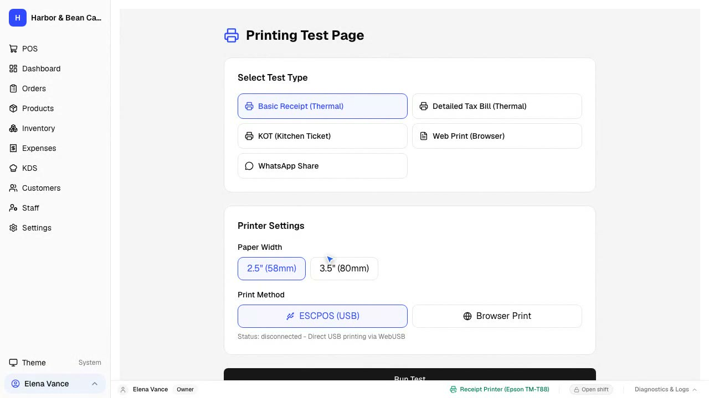

<div align="center">
  <h1>Rest&amp;Cafe</h1>
  <p><strong>A local-only, offline-first point of sale for restaurants and cafés — no cloud, no accounts, no phone-home.</strong></p>
  <p>
    <a href="https://github.com/abo3dam-hub/Rest-Cafe">Repository</a> ·
    <a href="docs/reference/product-invariants.md">Product invariants</a> ·
    <a href="https://github.com/abo3dam-hub/Rest-Cafe/issues">Report a bug</a>
  </p>
  <p>
    
    
  </p>
</div>

Rest&Cafe is a fork of [FloCafe](https://github.com/FreeOpenSourcePOS/FloCafe) rebuilt for a
single promise: **everything runs on the restaurant's own computer and nothing leaves it.**
Orders, customers, receipts, and backups live in a local SQLite database. Cloud sync and
telemetry are removed in code (not just switched off), the WhatsApp integration is gone, and
updates are fully manual — new builds are produced from this repository and installed by hand.

The fork is configured for its home market out of the box — Syrian pound (`SYP`) with the
currency unit `SP`, whole amounts (never `10.00`), Latin digits, `Asia/Damascus` timezone —
while every one of those values stays an ordinary, owner-editable setting. There are no
country profiles anywhere in the product.

## Get Rest&Cafe

Rest&Cafe is distributed as a Windows installer built from this repository:

1. Open the repository's **Actions** tab and run the **Build Windows installer** workflow
   (it is manual-trigger only; there is no automatic update channel).
2. Download the `rest-cafe-windows-installer` artifact from the finished run.
3. Run the installer. It is unsigned, so Windows SmartScreen will warn on first launch —
   choose **More info → Run anyway**.

The installed app keeps its data in the `RestCafe` user-data folder; reinstalling or
updating the app never touches the database.

### System requirements

| Requirement | Minimum |
| --- | --- |
| Operating system | Windows 10+ (64-bit) |
| Memory | 4 GB RAM |
| Storage | 500 MB free space, plus room for local backups |

Node.js is only required to develop Rest&Cafe, not to run a packaged release.

A terminal that can only run a lightweight browser can still be used without installing
the desktop app locally:

- **Waiter handhelds:** open the Server App over the LAN.
- **Customer ordering:** each table gets a QR code (Settings → Server App → Customer
  self-ordering); customers order from their phones and the order lands at the cashier,
  the kitchen display, and the kitchen printer.
- **KDS station:** open the KDS URL shown in the app; the KDS is a separate LAN-served
  display on its own port.

## Key features

<table>
  <tr>
    <td width="50%" valign="top">
      <h3>High-Speed Counter POS</h3>
      <p>Fast, touch-optimized checkout built for busy café rushes. Filter menu categories with a tap, pin the staples (water, coffee, arguileh) to the front, shrink the item cards to fit more on screen, mark an item sold out in one tap, and take cash payments with zero lag.</p>
      <p><a href="docs/README.md">Documentation &rarr;</a></p>
    </td>
    <td width="50%">
      <picture>
        <source srcset="docs/assets/showcase/pos-checkout.gif" type="image/gif">
        
      </picture>
    </td>
  </tr>
  <tr>
    <td width="50%" valign="top">
      <h3>Custom Modifiers &amp; Add-ons</h3>
      <p>Tailor every drink and dish to customer preferences. Configure milk selections (whole, oat, almond), extra espresso shots, syrup flavors, and kitchen prep instructions effortlessly.</p>
    </td>
    <td width="50%">
      <picture>
        <source srcset="docs/assets/showcase/addon-modifiers.gif" type="image/gif">
        
      </picture>
    </td>
  </tr>
  <tr>
    <td width="50%" valign="top">
      <h3>Real-Time Kitchen Display (KDS)</h3>
      <p>Keep kitchen staff and baristas in sync with a digital ticket board. Drag orders from waiting to preparing to ready, track prep times, and eliminate lost paper tickets.</p>
      <p><a href="docs/architecture/frontend.md">Kitchen display notes &rarr;</a></p>
    </td>
    <td width="50%">
      <picture>
        <source srcset="docs/assets/showcase/kds-kanban.gif" type="image/gif">
        
      </picture>
    </td>
  </tr>
  <tr>
    <td width="50%" valign="top">
      <h3>Visual Tables &amp; Floor Plan</h3>
      <p>See your entire dining area at a glance. Track occupied and open tables, see when each party was seated, take reservations with a customer name and arrival time, and view checks instantly.</p>
    </td>
    <td width="50%">
      <picture>
        <source srcset="docs/assets/showcase/floorplan-tables.gif" type="image/gif">
        
      </picture>
    </td>
  </tr>
  <tr>
    <td width="50%" valign="top">
      <h3>Handheld Waiter App</h3>
      <p>Take orders right at the table from any smartphone or tablet. Servers select menu items, apply modifiers, and fire tickets directly to the kitchen without walking back to the counter.</p>
    </td>
    <td width="50%">
      <picture>
        <source srcset="docs/assets/showcase/server-app.gif" type="image/gif">
        
      </picture>
    </td>
  </tr>
  <tr>
    <td width="50%" valign="top">
      <h3>Split Payments &amp; Multi-Tender</h3>
      <p>Split a bill by item — a leaving guest pays exactly what he ordered — or accept multiple payment types on a single ticket, with automatic change calculations.</p>
    </td>
    <td width="50%">
      <picture>
        <source srcset="docs/assets/showcase/split-payments.gif" type="image/gif">
        
      </picture>
    </td>
  </tr>
  <tr>
    <td width="50%" valign="top">
      <h3>Supplies &amp; Stock Tracking</h3>
      <p>Manage raw ingredients and café supplies with precision. Record stock deliveries, waste, and manual adjustments, track unit costs, and review complete movement audit logs.</p>
    </td>
    <td width="50%">
      <picture>
        <source srcset="docs/assets/showcase/recipe-inventory.gif" type="image/gif">
        
      </picture>
    </td>
  </tr>
  <tr>
    <td width="50%" valign="top">
      <h3>Thermal Receipt &amp; Kitchen Printing</h3>
      <p>Print clean customer receipts and kitchen order slips on standard 58mm or 80mm thermal receipt printers over USB or local network, complete with itemized tax summaries.</p>
      <p><a href="docs/printers.md">Printer configuration guide &rarr;</a></p>
    </td>
    <td width="50%">
      <picture>
        <source srcset="docs/assets/showcase/thermal-printing.gif" type="image/gif">
        
      </picture>
    </td>
  </tr>
</table>

### Also in the box

- **Offline-first architecture:** Local SQLite storage with auto-migrating schema and fail-closed safety.
- **Granular roles & permissions:** Owner, Manager, Cashier, Server, and Chef roles with context-aware access policies.
- **Multi-language support:** 24 localized languages with full bidirectional RTL rendering (Arabic, Persian, Urdu), and a self-hosted Arabic typeface (IBM Plex Sans Arabic) so Arabic never depends on whatever font the PC happens to have.
- **Manual tax rules:** One generic local tax pack; rates are owner-configured and tax can be off or manual.
- **Automated database backups:** Pre-migration automatic snapshots and manual exports, stored locally.
- **Customer CRM:** Customer directory and purchase histories.
- **Cash drawer management:** Cash pulse on checkout and end-of-shift cash drawer reconciliations.
- **Reports & accounting export:** Daily, sales, cash-session, and dish-profitability reports (per-dish margin and menu-engineering classes) with audit-ready CSV/Excel export and financial reconciliation identities.
- **Sold-out that is never forgotten:** A one-tap «sold out» state on any item, a permanent count badge on the POS, and a start-of-day reminder listing anything still sold out from yesterday.
- **New-order sound alerts:** A generated chime plus a visual pill on the kitchen display and the cashier screen whenever a new order lands.

## Project status

Rest&Cafe is in active development for its first restaurant deployment. Core customer data and upgrade safety are treated carefully, including explicit database migrations and recovery mechanisms. The default visual identity (name and logo, both changeable in Settings) is Al Malaki Pizza & Café, the first deployment.

## Offline-first by design

Core POS operation and local data are offline-first. Order entry, billing, KDS coordination, and receipt printing do not depend on internet access or external cloud services.

- **Data location:** The SQLite database and local backups reside in the operating system user-data directory, separate from installed application binaries. Standard in-place application updates do not remove them. As a best practice, create a manual backup before reinstalling, moving to a new machine, or changing distribution channels.
- **Pre-migration backups:** Rest&Cafe automatically creates a timestamped database backup before running schema migrations.
- **Optional network features:** None outbound. The app serves the POS, the kitchen display, and the Server App on the local network only. Cloud sync, telemetry, WhatsApp, and Google Drive were removed from this fork in code.

## Languages and regional support

Rest&Cafe includes UI translations for:

- English
- Spanish
- French
- Brazilian Portuguese
- Russian
- Filipino
- Turkish
- Persian (Farsi), including RTL support
- Arabic, including RTL support
- Urdu, including RTL support
- German
- Italian
- Japanese
- Simplified Chinese
- Traditional Chinese (Taiwan)
- Korean
- Bahasa Indonesia
- Dutch
- Hindi
- Bengali/Bangla
- Albanian
- Vietnamese
- Thai
- Nepali

UI language is independent of store country and regional settings, and tax calculation rules remain a separate concern. For details on contributing translations or adding languages, see the [Internationalization and translation guide](docs/architecture/internationalization.md).

Rest&Cafe has **no country profiles**. A store's regional identity is its own plain
settings: an ISO 4217 currency, a merchant-editable currency unit (the text printed after
amounts — `SP` by default), and a timezone. Product defaults are `SYP`, unit `SP`, and
`Asia/Damascus`; fraction digits follow ISO 4217 (SYP renders whole amounts: `10`, never
`10.00`) and digits always render Latin.

## Tax support

Taxes are manual and owner-controlled. The owner enables taxes in Settings and defines
categories and rates in the manual tax configuration; the generic calculation engine
applies them at checkout and on receipts. This fork ships no country tax packs and never
downloads one — the only bundled pack is the empty generic framework.

> **Notice:** Rest&Cafe is software, not legal or tax advice. Operators remain
> responsible for verifying the requirements that apply to their business.

## Development

Setting up a local development environment requires Node.js 22 or later:

```sh
git clone https://github.com/abo3dam-hub/Rest-Cafe.git
cd Rest-Cafe
npm install
npm run dev
```

`npm run dev` builds the frontend and backend, then launches Electron.

### Architecture

```text
Electron main process
├── Express API and WebSocket server       :3001
├── Standalone kitchen-display server      :3002
├── Server / waiter app server             :3003
└── SQLite database, migrations, and printing
                 ↕ HTTP and WebSocket
Next.js renderer
└── React UI and Zustand client state
```

For detailed developer workflows, coding standards, branch conventions, and testing procedures, see [CONTRIBUTING.md](CONTRIBUTING.md).

## Contributing

Contributions are welcome. Please check [CONTRIBUTING.md](CONTRIBUTING.md) before starting work:

- **Small bug fixes, documentation improvements, and focused tests** can be started freely.
- **New features, database schema changes, and architectural refactors** require maintainer discussion and approval before implementation.

If Rest&Cafe is useful to you, consider starring the repository.

## Help and documentation

- **Documentation index:** [docs/README.md](docs/README.md)
- **Printer guide & troubleshooting:** [docs/printers.md](docs/printers.md)
- **Internationalization & translations:** [docs/architecture/internationalization.md](docs/architecture/internationalization.md)
- **Bug reports & feature proposals:** [GitHub Issues](https://github.com/abo3dam-hub/Rest-Cafe/issues)
- **General questions & ideas:** [GitHub Discussions](https://github.com/abo3dam-hub/Rest-Cafe/discussions)

## License

Rest&Cafe is open-source software licensed under the [MIT License](LICENSE).
